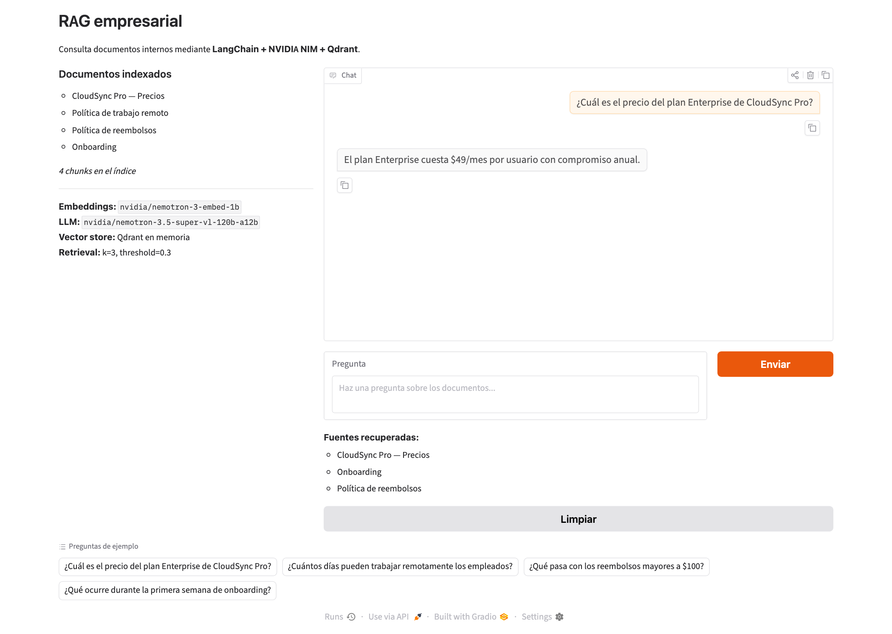
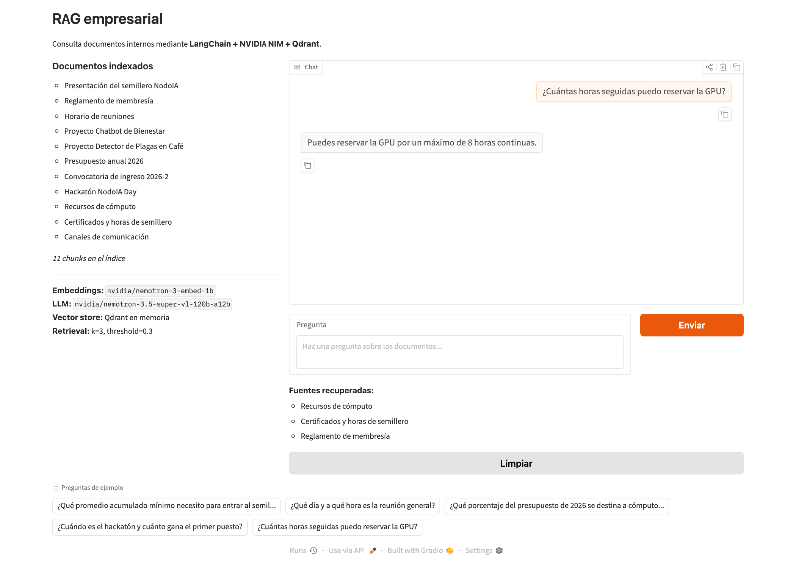
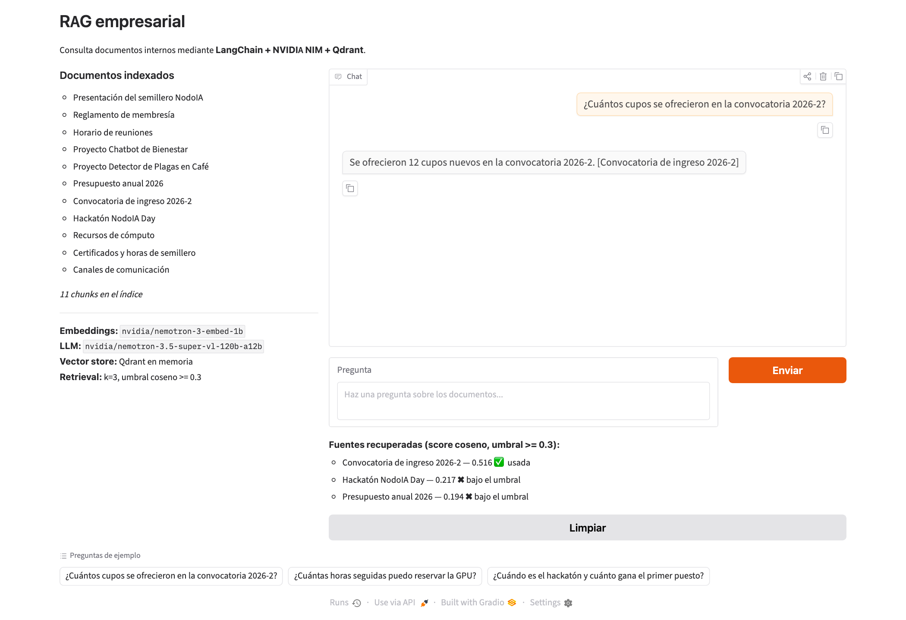

# Respuestas del workshop RAG

**Juan David Sierra Orozco** · SI3003 Inteligencia Artificial · 21 de octubre de 2026

Todas las cifras y tablas salen de ejecuciones reales de los notebooks de `notebooks/`. El modelo de generación es `nvidia/nemotron-3.5-super-vl-120b-a12b` (mi cuenta no tiene habilitado el `nemotron-3-super-120b-a12b` del curso, ver README).

---

# Bloque 0 · Teoría

## T1 · Cuántos nodos viven en cada capa

_Evidencia:_

Cálculo a mano. Con M = 16, mL = 1/ln(16) ≈ 0,3607 y P(capa ≥ k) = 16^(-k). Con N = 1.000.000:

- Capa ≥ 1: 1.000.000 / 16 = 62.500
- Capa ≥ 2: 1.000.000 / 256 = 3.906,25 ≈ 3.906
- Capa ≥ 3: 1.000.000 / 4.096 = 244,14 ≈ 244

Simulación (semilla fija `default_rng(0)`, `l = floor(-ln(U) * mL)`, U en (0,1]). Salida real del código:

```
capa >= 1: simulado= 62,675 teórico=   62,500
capa >= 2: simulado=  4,005 teórico=    3,906
capa >= 3: simulado=    270 teórico=      244
conteo exacto por capa: {0: 937325, 1: 58670, 2: 3735, 3: 255, 4: 14} max 5
```

| Capa mínima | Teórico | Simulado | Diferencia |
|---|---|---|---|
| ≥ 1 | 62.500 | 62.675 | +0,28 % |
| ≥ 2 | 3.906 | 4.005 | +2,5 % |
| ≥ 3 | 244 | 270 | +10,7 % |

_Mi respuesta / análisis:_

El simulado y el teórico coinciden en el orden de magnitud y la diferencia relativa crece al subir de capa, lo cual es normal: en la capa 3 hablo de unos 244 nodos, así que una desviación de 26 es ruido de muestreo (la desviación típica de una binomial con esa media es cerca de 16). Cada capa tiene unas 16 veces menos nodos que la anterior, como predice M^-k. Los hubs de las capas altas son pocos (unos 270 de un millón) y por eso la búsqueda arranca recorriendo un grafo diminuto con enlaces largos, que acerca la consulta a la zona correcta en muy pocos saltos. Después baja por capas cada vez más densas y sólo en la capa 0 hace el trabajo fino, así que el costo crece con log N y no con N.

Una observación que hice al comparar con la presentación de inserción: ahí dicen que l = 0 pasa ~63 %, l = 1 ~23 % y l ≥ 2 ~14 %, y que la capa 1 tiene ~37 % de los nodos. Esas cifras corresponden a mL = 1 (probabilidad e^-k). Con mL = 1/ln(M) y M = 16, lo que sale es que ~93,7 % se queda en la capa 0 y ~6,25 % llega a la capa 1, que es lo que mostró mi simulación (937.325 nodos con l = 0). Me quedo con mis números porque salen del mL que pide el enunciado.

## T2 · ef, k y el tamaño de la cola

_Evidencia:_

Tomado de `hnsw_busqueda.html`, sección "ef y recall":

- "ef debe ser siempre ≥ k. Si pides k=10 resultados con ef=5, solo tienes 5 candidatos para elegir, imposible retornar 10."
- "Regla práctica: empieza con ef = 2·k. Si el recall es insuficiente, súbelo." Para RAG, ef = 50 a 100 con k = 5 a 10 da más de 95 % de recall.
- "ef se puede cambiar en cada búsqueda sin reconstruir el índice" y es "el único parámetro que puedes ajustar en producción sin reconstruir".

Cuenta rápida: con k = 10 la regla da ef inicial = 2 · 10 = 20.

_Mi respuesta / análisis:_

1. Con k = 10 y ef = 5 falla la capa 0: la cola de candidatos sólo guarda 5 nodos, y la fase 3 retorna los k mejores de esa cola. No hay de dónde sacar 10, así que o devuelve 5 resultados o la librería lo rechaza (en la práctica se corrige subiendo ef hasta k). La cola es el techo de cuántos vecinos puedo ver.
2. Conviene empezar con ef = 2·k (en el ejemplo, 20) y subirlo sólo cuando mido que el recall es insuficiente. En RAG típico basta ef entre 50 y 100. Subir ef compra recall pero cuesta latencia, así que no lo subo a ciegas.
3. Se puede cambiar `ef` (el de búsqueda) sin reconstruir nada. `ef_construction` no: sólo interviene al insertar vectores, y su efecto ya quedó guardado en la calidad de las aristas del grafo. Para que un valor nuevo de `ef_construction` tuviera efecto tendría que reinsertar todo el índice. Es el mismo concepto (tamaño de la cola) en momentos distintos: uno en el build, otro en cada query.

## T3 · Inserción frente a búsqueda

_Evidencia:_

| | Inserción | Búsqueda |
|---|---|---|
| ¿Se sortea la capa? | Sí, `l = floor(-ln(U) · mL)` | No, siempre se entra por la capa más alta desde el nodo de entrada global |
| Valor de ef en las capas altas | ef = 1 (de la capa más alta hasta l+1) | ef = 1 (de la capa más alta hasta la 1) |
| Parámetro de la fase principal | `ef_construction`, desde la capa l hasta la 0 | `ef`, sólo en la capa 0 |
| ¿Modifica el índice? | Sí, agrega nodo y aristas | No, sólo lee el grafo |

En el notebook 03:

- `vectorstore.add_documents(...)` dispara la **inserción** (cada chunk se vectoriza y entra al índice con este proceso).
- `retriever.invoke(...)` dispara la **búsqueda** (la pregunta se vectoriza y se buscan los k vecinos).

_Mi respuesta / análisis:_

- **Sorteo de capa.** Al insertar tengo que decidir hasta qué piso vive el vector nuevo; lo hago al azar para que los hubs no dependan del orden en que llegaron los datos. Al buscar no hay nada que decidir: la consulta no pertenece al grafo, así que sólo entro por arriba y bajo.
- **ef en capas altas.** En las dos operaciones uso ef = 1 allí porque en esas capas sólo quiero llegar rápido a la zona correcta y no hace falta precisión; el costo de ser exhaustivo no se justifica en un grafo tan disperso.
- **Parámetro de la fase principal.** En inserción la cola es `ef_construction` (grande, 200 típico) porque de ahí salen los M vecinos con los que conecto el nodo y quiero buenas aristas para siempre. En búsqueda es `ef` (50 típico) porque sólo me importa el recall de esta consulta y puedo ajustarlo cuando quiera. Además, en inserción empiezo la fase principal en la capa l y en búsqueda siempre en la 0.
- **Modifica el índice.** Insertar escribe (nodo nuevo, aristas bidireccionales y poda de vecinos pasados de M_max); buscar sólo lee, por eso puedo lanzar muchas consultas sin cambiar el grafo.

## T4 · El invariante de FAISSVectorStore

_Evidencia:_

Salida real del script que recorre los índices uno por uno (`docs` es lo que FAISS cree, `after` es la lista tras borrar B):

```
1 B C
2 C D
3 D IndexError
```

Tabla posición → documento:

| Posición FAISS | Antes (FAISS y lista coinciden) | Después de borrar B de `self.documents` | Qué ve la búsqueda |
|---|---|---|---|
| 0 | A | A | A (correcto) |
| 1 | B | C | devuelve C pero el vector era el de B (error) |
| 2 | C | D | devuelve D pero el vector era el de C (error) |
| 3 | D | no existe (la lista sólo llega a la posición 2) | `IndexError: list index out of range` |

Una búsqueda que antes daba `[1, 2, 3]` (B, C, D) ahora resuelve así: `documents[1]` = C, `documents[2]` = D, `documents[3]` = excepción.

_Mi respuesta / análisis:_

El índice FAISS sigue con 4 vectores en las posiciones 0 a 3, pero la lista quedó con 3 chunks, así que todo lo que está después de B se corrió una posición. Ahora la búsqueda de `[1, 2, 3]` entrega primero C (cuando el vector que matcheó era el de B), luego D (cuando era el de C), y en el índice 3 se rompe.

Los dos primeros son el error silencioso: no hay excepción, el sistema contesta con tranquilidad un texto que no corresponde al vector que ganó, y en un RAG eso termina en una respuesta del LLM basada en el contexto equivocado y sin ninguna señal de alarma. El tercero (índice 3) es el que lanza `IndexError`, que paradójicamente es el menos peligroso porque se nota. Y aunque `id_to_index` también quedaría desfasado, ése no se usa durante la búsqueda, así que tampoco avisa.

Esto conecta con la última sección de `faiss_explicado.html`: `IndexFlatIP` no tiene operación de borrado, y si borro de la lista debería reconstruir todo el índice para no romper el invariante posición i = `documents[i]`. Esa es una de las razones por las que existen Qdrant o Weaviate: gestionan inserciones, borrados y actualizaciones de forma nativa, con ids propios, sin que yo tenga que mantener a mano la correspondencia entre enteros y documentos.

## T5 · El costo de la fuerza bruta

_Evidencia:_

Salida real del código:

```
7.68e+10 76800000000
```

768.000.000 multiplicaciones por consulta × 100 consultas por segundo = **7,68 × 10^10** multiplicaciones por segundo (76.800 millones, es decir 0,0768 × 10^12).

_Mi respuesta / análisis:_

Ser exacto significa comparar la consulta contra los 1.000.000 de vectores, y el costo es O(N·d) con N = 10^6 y d = 768. Para sostener 100 consultas por segundo tendría que ejecutar 7,68 × 10^10 multiplicaciones cada segundo, y eso sin contar las sumas, la lectura de unos 3 GB de vectores float32 desde memoria en cada pasada ni el crecimiento lineal cuando N sube a 10 millones o más. Se vuelve inviable en una CPU normal y obliga a hardware caro (o a GPUs) por algo que HNSW resuelve con costo cercano a O(log N).

En ANN se sacrifica una pequeña fracción de exactitud (a veces el vecino devuelto no es el verdadero más cercano, con recall típico mayor a 95 %) y se gana velocidad de órdenes de magnitud (la presentación habla de ~10.000 veces más rápido que la fuerza bruta con N = 1M y d = 768).

---

# Bloque A · App RAG empresarial

## A1 · Ejecuta la app RAG de punta a punta

_Evidencia:_ ejecuté `notebooks/02b_rag_app_nvidia_nim_colab.ipynb` de punta a punta (salidas guardadas en el notebook) con los 4 documentos de demostración, que generan **4 chunks**. Para la generación usé `nvidia/nemotron-3.5-super-vl-120b-a12b`, porque mi cuenta devuelve 404 con `nvidia/nemotron-3-super-120b-a12b`. Captura de Gradio con respuesta y fuentes: `evidencias/A1_gradio.png`.



| # | Pregunta | Respuesta | Fuentes recuperadas |
|---|---|---|---|
| 1 | ¿Cuál es el precio del plan Enterprise de CloudSync Pro? | $49/mes por usuario con compromiso anual. | CloudSync Pro — Precios; Onboarding; Política de reembolsos |
| 2 | ¿Cuántos días pueden trabajar remotamente los empleados? | Hasta 3 días por semana, con aprobación del jefe directo. | Política de trabajo remoto; Onboarding; Política de reembolsos |
| 3 | ¿Qué pasa con los reembolsos mayores a $100? | Requieren aprobación del supervisor; una vez aprobados se procesan en 3 a 5 días hábiles al método de pago original. | Política de reembolsos; Política de trabajo remoto; CloudSync Pro — Precios |
| 4 | ¿Qué ocurre durante la primera semana de onboarding? | Se completan módulos obligatorios de seguridad, cumplimiento y cultura de la empresa. | Onboarding; Política de trabajo remoto; Política de reembolsos |
| 5 (fuera de los documentos) | ¿Cuál es la política de vacaciones de la empresa? | No tengo información sobre la política de vacaciones de la empresa en el contexto proporcionado. | Política de trabajo remoto; Onboarding; Política de reembolsos |

_Mi respuesta / análisis:_ Las 4 preguntas de ejemplo salieron correctas y el documento correcto apareció siempre como primera fuente. La pregunta fuera de los documentos recibió una negativa honesta, que es lo que quería ver. Lo que me llamó la atención es que, en esa quinta pregunta, el sistema igual mostró tres fuentes que no tienen nada que ver con vacaciones. Con solo 4 documentos y `k=3`, el retriever devuelve casi todo el índice en cada consulta, así que la lista de fuentes por sí sola no prueba que el sistema encontró algo relevante. Más adelante, en A4, explico por qué el `score_threshold=0.3` del notebook no estaba filtrando nada.

## A2 · Tu propio corpus de documentos

_Evidencia:_ `data/company_documents.json` tiene **11 documentos** de NodoIA, un semillero de IA de EAFIT que inventé (reglamento, horarios, dos proyectos, presupuesto, convocatoria, hackatón, recursos de cómputo, certificados y contacto). Cada documento trae `id`, `title`, `content` y `metadata` con dos claves (`department` y `type`). El notebook lo carga probando rutas relativas (`data/company_documents.json`, `../data/company_documents.json` y `company_documents.json`), así que funciona desde `notebooks/`, desde la raíz del repo o en Colab. Captura: `evidencias/A2_corpus.png`.



**chunk_size:** mis documentos miden entre 361 y 591 caracteres. Con el valor original (400, overlap 40) salían 18 chunks y 7 de los 11 documentos quedaban partidos en dos. Con `chunk_size=700` y `chunk_overlap=70` salen 11 chunks, uno por documento. Lo medí en la celda de conteo del notebook.

| # | Pregunta | ¿En el corpus? | Respuesta | Fuentes recuperadas | ¿Correcta? |
|---|---|---|---|---|---|
| 1 | ¿Qué promedio acumulado mínimo necesito para entrar al semillero? | sí | Un promedio acumulado mínimo de 3,5. | Reglamento de membresía; Recursos de cómputo; Presentación del semillero NodoIA | Sí |
| 2 | ¿Qué día y a qué hora es la reunión general? | sí | Los martes de 6:00 p. m. a 8:00 p. m. | Horario de reuniones; Reglamento de membresía; Canales de comunicación | Sí |
| 3 | ¿Qué porcentaje del presupuesto de 2026 se destina a cómputo en la nube? | sí | El 40 %. | Presupuesto anual 2026; Hackatón NodoIA Day; Convocatoria de ingreso 2026-2 | Sí |
| 4 | ¿Cuándo es el hackatón y cuánto gana el primer puesto? | sí | El 14 de noviembre de 2026; el primer puesto gana 1.500.000 pesos. | Hackatón NodoIA Day; Horario de reuniones; Recursos de cómputo | Sí |
| 5 | ¿Cuántas horas seguidas puedo reservar la GPU? | sí | Hasta 8 horas continuas. | Recursos de cómputo; Certificados y horas de semillero; Reglamento de membresía | Sí |
| 6 | ¿Cuánto cuesta la matrícula de la maestría en IA de EAFIT? | no | No tengo esa información; el contexto solo trata del semillero NodoIA. | Presentación del semillero NodoIA; Hackatón NodoIA Day; Reglamento de membresía | Sí (rechazó bien) |
| 7 | ¿Quién ganó el Mundial de fútbol de 2022? | no | No tengo esa información en el contexto proporcionado. | Hackatón NodoIA Day; Convocatoria de ingreso 2026-2; Proyecto Chatbot de Bienestar | Sí (rechazó bien) |

_Mi respuesta / análisis:_ Las 5 preguntas que sí están en el corpus se respondieron bien y el primer documento recuperado fue el correcto en las 5; las 2 que no están se rechazaron sin inventar nada. Elegí la pregunta de la maestría a propósito porque está cerca del tema (EAFIT, IA) y aun así el modelo no se dejó engañar. Subí el `chunk_size` porque el título va en la metadata y no en el texto que se embebe: un documento partido en dos deja un segundo pedazo sin el contexto de a qué se refiere, y mis documentos ya eran unidades de significado completas. Con 700 caracteres cada documento es un chunk, y el costo es que el chunk es algo más largo, lo cual con corpus de este tamaño no me preocupa.

## A3 · Ingeniería del prompt (antes y después)

_Evidencia:_ diff del system prompt (en el notebook quedó como dos constantes, `SYSTEM_PROMPT_ANTES` y `SYSTEM_PROMPT_DESPUES`, y `build_pipeline` recibe el prompt como parámetro):

```diff
 Eres un asistente empresarial. Responde únicamente con información del contexto proporcionado.
-Si el contexto no contiene la respuesta, indica que no tienes esa información.
-Responde en español y de forma concisa.
+Cita siempre el título del documento entre corchetes, por ejemplo [Política de reembolsos].
+Si el contexto no alcanza, responde exactamente: «No encuentro esa información en los documentos.»
+Responde en español, en máximo 3 oraciones.
```

| Tipo | Pregunta | ANTES | DESPUÉS |
|---|---|---|---|
| Fácil | ¿Cuántas horas seguidas puedo reservar la GPU? | Hasta 8 horas continuas. | Puedes reservar la GPU por un máximo de 8 horas continuas [Recursos de cómputo]. |
| Ambigua | ¿Cuándo es la reunión? | La reunión general de NodoIA es los martes de 6:00 p. m. a 8:00 p. m. en el bloque 19, sala 302. | La reunión general de NodoIA es los martes de 6:00 p. m. a 8:00 p. m. en el bloque 19, sala 302 [Horario de reuniones]. Los jueves de 4:00 p. m. a 6:00 p. m. hay sesión de laboratorio práctico en la sala de cómputo [Horario de reuniones]. Durante las semanas de parciales las reuniones se suspenden y se avisa por Discord [Horario de reuniones]. |
| Fuera de contexto | ¿Quién ganó el Mundial de fútbol de 2022? | No tengo esa información en el contexto proporcionado. | No encuentro esa información en los documentos. |

| Tipo | Cita [título] antes / después | Frase fija antes / después | Oraciones antes / después |
|---|---|---|---|
| Fácil | no / sí | no / no (no aplica) | 1 / 1 |
| Ambigua | no / sí | no / no (no aplica) | 1 / 3 |
| Fuera de contexto | no / no (no aplica) | no / sí | 1 / 1 |

_Mi respuesta / análisis:_ La instrucción con efecto más visible fue la de citar el título entre corchetes: pasó de 0 citas a citar en las 2 respuestas donde había contexto, y la de la frase fija también se cumplió al pie de la letra en la pregunta fuera de contexto (antes el modelo decía otra cosa con palabras propias). Con solo 3 preguntas, esa segunda conclusión descansa en una única observación. La instrucción que el modelo cumplió peor fue la de brevedad: en la pregunta ambigua la respuesta pasó de 1 a 3 oraciones, justo en el tope, y cada oración repitió la misma cita, así que el límite de 3 no hizo la respuesta más concisa sino que la llenó. Lo curioso es que el prompt viejo respondió la pregunta ambigua con una sola reunión, mientras que el nuevo cubrió también el laboratorio y la suspensión por parciales, o sea que la ambigüedad se resolvió mejor con la instrucción de citar (el modelo parece "ver" más los documentos cuando tiene que referenciarlos). No encontré una instrucción ignorada del todo en estas 3 preguntas; la salvedad es que en la verificación de A4 la frase fija apareció también en una pregunta con contexto relevante (ver A4), lo que sugiere que (b) a veces se aplica de más.

## A4 · Muestra el score de similitud en las fuentes

_Evidencia:_ `build_pipeline` ahora devuelve `(pipeline, chunks, vectorstore)` y `chat()` llama a `vectorstore.similarity_search_with_score(question, k=3)` para mostrar cada fuente con su score coseno y si pasa el umbral. Captura: `evidencias/A4_scores.png`.



Scores (coseno, sin filtrar):

| Tipo | Pregunta | Fuente 1 | Fuente 2 | Fuente 3 |
|---|---|---|---|---|
| Buena | ¿Cuántos cupos se ofrecieron en la convocatoria 2026-2? | Convocatoria de ingreso 2026-2 (0.516) | Hackatón NodoIA Day (0.217) | Presupuesto anual 2026 (0.194) |
| Buena | ¿Qué pasa si falto a tres reuniones seguidas? | Reglamento de membresía (0.354) | Horario de reuniones (0.252) | Certificados y horas de semillero (0.129) |
| Buena | ¿Cuántos integrantes tiene el proyecto de plagas en café? | Proyecto Detector de Plagas en Café (0.524) | Presentación del semillero NodoIA (0.192) | Reglamento de membresía (0.159) |
| Fuera | ¿Cuál es el horario de la biblioteca de EAFIT? | Reglamento de membresía (0.245) | Presentación del semillero NodoIA (0.224) | Hackatón NodoIA Day (0.206) |
| Fuera | ¿Cuál es la receta de la bandeja paisa? | Presupuesto anual 2026 (0.070) | Hackatón NodoIA Day (0.063) | Presentación del semillero NodoIA (0.057) |

Para tener más datos calculé también el top-1 de las 7 preguntas de A2: las 5 buenas dieron 0.388 a 0.570 (0.437, 0.388, 0.570, 0.532, 0.564) y las 2 fuera de contexto dieron 0.393 (maestría) y 0.114 (Mundial). Con las 8 buenas, el top-1 mínimo es 0.354; con las 4 fuera de contexto, el máximo es 0.393.

**Hallazgo sobre el umbral actual:** `QdrantVectorStore` compara `score_threshold` contra una relevancia `(coseno + 1) / 2`, no contra el coseno. Lo comprobé con la pregunta del Mundial: coseno 0.114 equivale a relevancia 0.557. Por eso `score_threshold=0.3` equivale a coseno >= -0.4 y no filtra nada, y eso explica que las preguntas fuera de contexto en A1 y A2 devolvieran siempre 3 fuentes.

**Umbral propuesto: coseno >= 0.30, que en la escala del retriever es `score_threshold=0.65`.** Efecto medido sobre mis datos:

| Umbral coseno | Buenas que conservan contexto (de 8) | Fuera de contexto que aún reciben contexto (de 4) |
|---|---|---|
| 0.30 | 8 | 1 |
| 0.40 | 6 | 0 |
| 0.50 | 5 | 0 |

Con el pipeline reconstruido a 0.65, las preguntas del Mundial, la bandeja paisa y la biblioteca llegaron al LLM sin ninguna fuente y respondió la frase fija; la de la maestría aún recibió 2 fuentes (su top-1 es 0.393) y el modelo igual respondió la frase fija. Entre las buenas, "reunión general" respondió bien con 1 fuente; en "¿Qué pasa si falto a tres reuniones seguidas?" llegó el Reglamento (0.354) pero el modelo respondió la frase fija; es discutible, porque la regla del documento habla de faltar a *más de* 3 reuniones.

_Mi respuesta / análisis:_ Los scores no separan limpiamente los dos grupos: el peor acierto (0.354) es más bajo que el mejor fuera de contexto (0.393, la pregunta de la maestría, que está cerca del tema). Por eso ningún umbral perfecto existe en mis datos: subirlo a 0.40 eliminaba todas las preguntas fuera de contexto pero también dejaba sin contexto a 2 de 8 preguntas buenas, y para un asistente me parece peor negar algo que sí está que dejar pasar un contexto flojo, porque el LLM ya demostró que rechaza bien cuando el contexto no responde. Por eso elijo 0.30: conserva las 8 buenas (con 0.054 de margen sobre la peor) y deja fuera los chunks de relleno, ya que los segundos y terceros lugares de las preguntas buenas no pasaron de 0.252. Es un umbral basado en 12 preguntas de un solo corpus pequeño, así que lo trataría como un punto de partida que hay que revalidar si el corpus crece.

---

